# Desk Editor for Laravel

`atannex/desk-editor` is a rich text editor and publishing platform for Laravel, built with TipTap 3 and ProseMirror.

It combines a configurable editor, editorial CMS, media library, collaboration tools, and a public blog. The compiled assets are included, so no frontend build step is required in the consuming Laravel application.

```blade
<x-desk-editor name="body" :value="$post->body" />
```

<p align="center">
  <picture>
    <source media="(prefers-color-scheme: dark)" srcset="https://raw.githubusercontent.com/atannex/desk-editor/main/art/screenshots/editor-dark.png">
    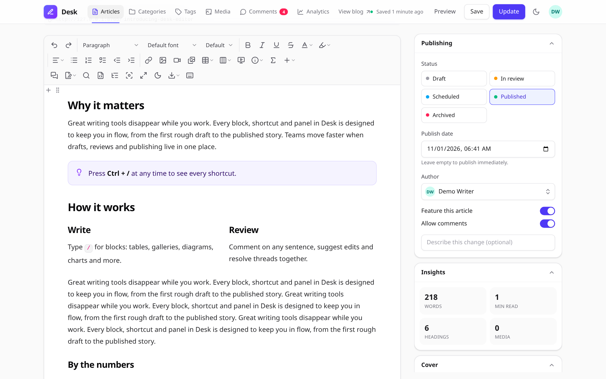
  </picture>
</p>

## Features

- **Rich editing:** headings, formatting, lists, tables, columns, callouts, code blocks, math, diagrams, charts, embeds, and Markdown shortcuts.
- **Media:** image uploads and editing, galleries, audio/video, attachments, responsive image variants, and a searchable media library.
- **Editorial tools:** inline comments, tracked suggestions, drafts, find and replace, outline, preview, and export.
- **Collaboration:** live co-editing, presence, coloured cursors, and document-level authorization.
- **CMS:** articles, authors, categories, tags, translations, revision history, review workflow, edit locks, and scheduled publishing.
- **Public blog:** article and taxonomy pages, reader comments, RSS/Atom, sitemap, SEO metadata, and analytics.
- **Integration:** Blade, Livewire, Filament, and a JavaScript API.
- **Accessibility and responsive UI:** keyboard navigation, reduced-motion support, and mobile-friendly controls.
- **Localization:** English, French, Spanish, German, Brazilian Portuguese, Arabic, and Simplified Chinese.

## Screenshots

<table>
  <tr>
    <td width="50%"><b>Light theme</b><br></td>
    <td width="50%"><b>Dark theme</b><br>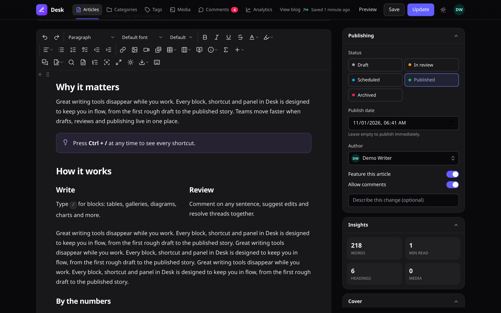</td>
  </tr>
  <tr>
    <td width="50%"><b>Slash commands: type <code>/</code> to insert any block</b><br>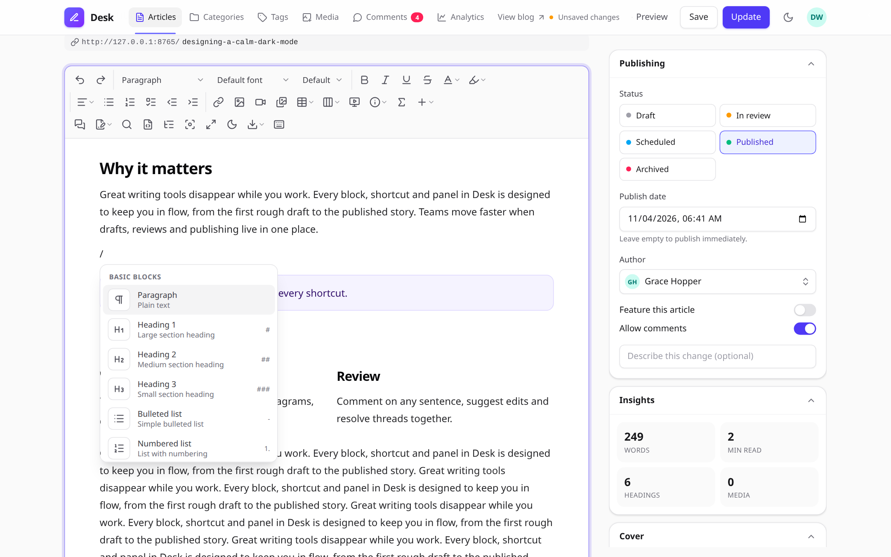</td>
    <td width="50%"><b>Bubble menu on any text selection</b><br>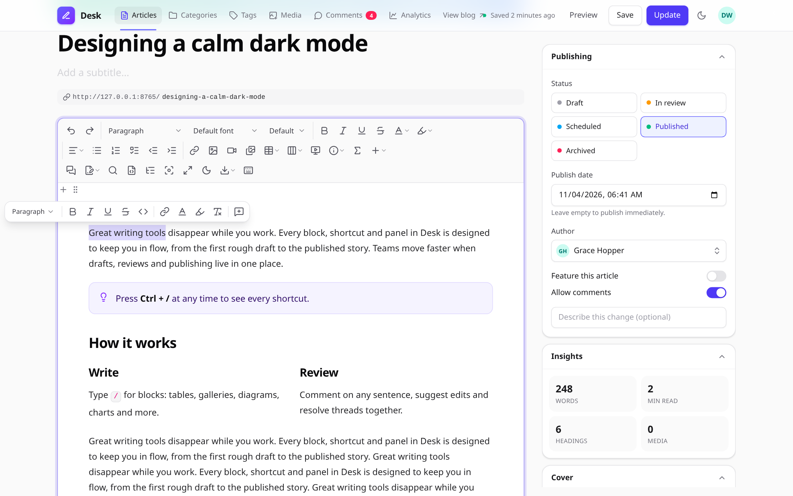</td>
  </tr>
  <tr>
    <td width="50%"><b>Comments and suggestion mode</b><br>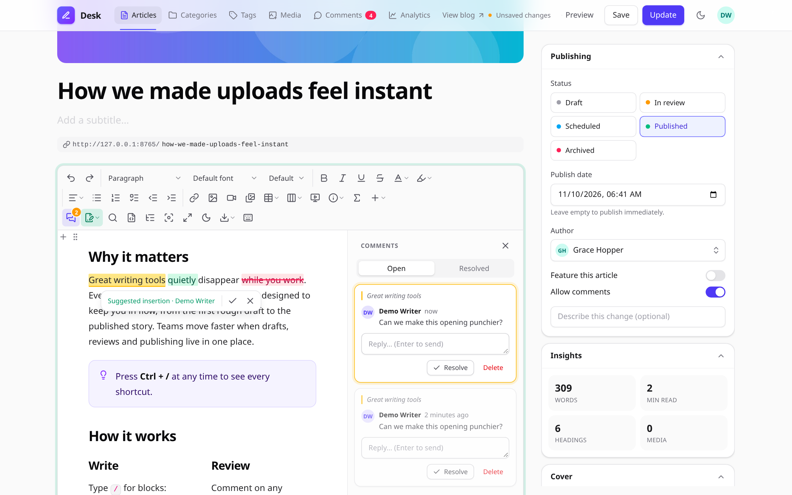</td>
    <td width="50%"><b>Live collaboration with named cursors</b><br>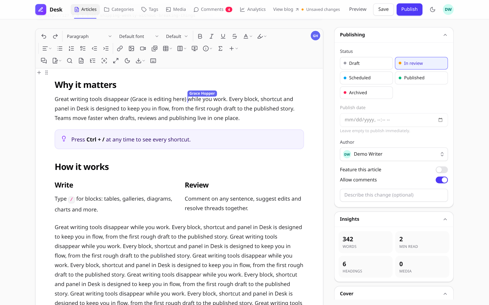</td>
  </tr>
  <tr>
    <td width="50%"><b>Diagram editor (Mermaid, live preview)</b><br>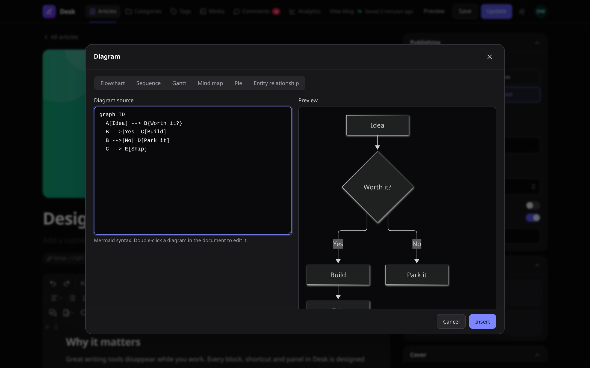</td>
    <td width="50%"><b>Chart editor (bar, line, pie and more)</b><br>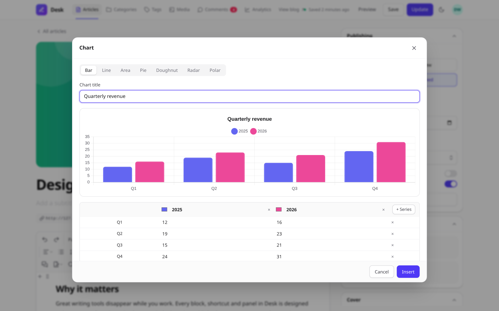</td>
  </tr>
  <tr>
    <td width="50%"><b>Image editor: crop, rotate, flip, filters</b><br>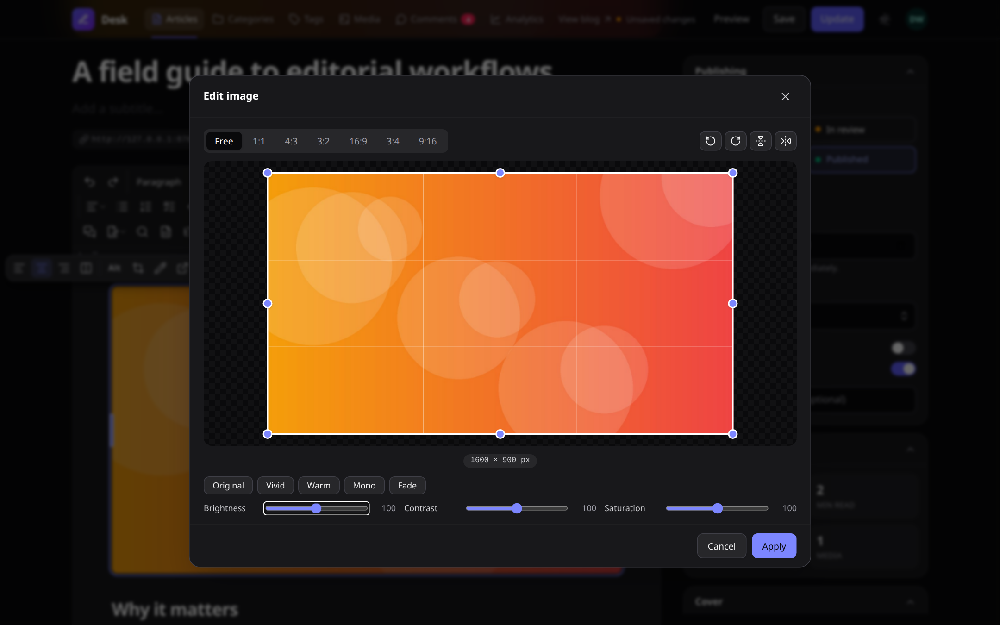</td>
    <td width="50%"><b>Media library</b><br>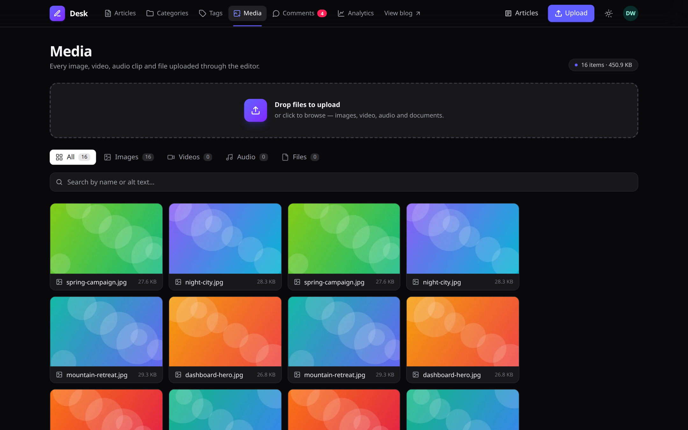</td>
  </tr>
  <tr>
    <td width="50%"><b>Article manager</b><br>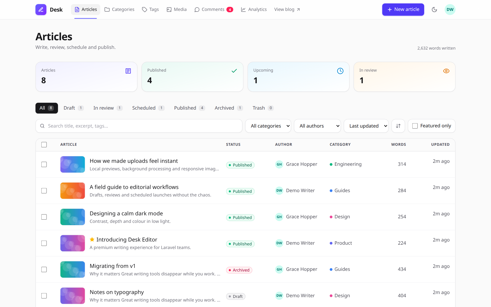</td>
    <td width="50%"><b>Analytics</b><br>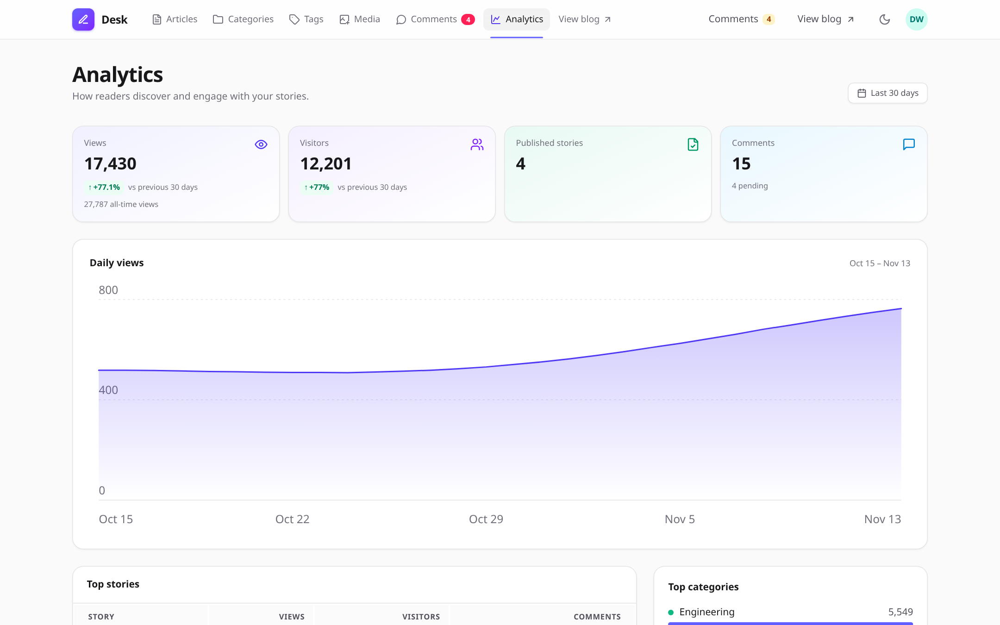</td>
  </tr>
  <tr>
    <td width="50%"><b>Public blog</b><br>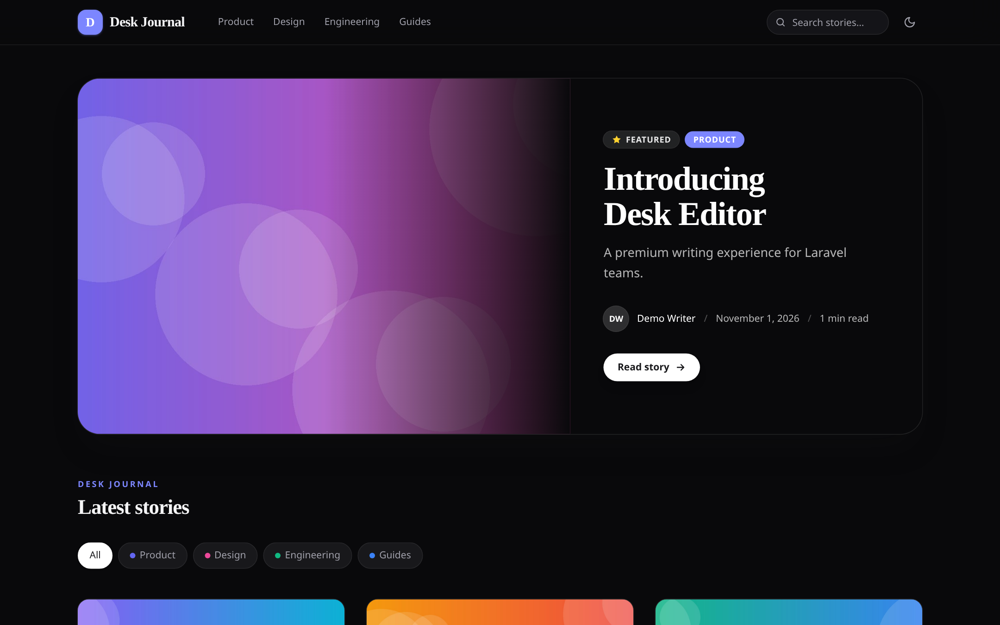</td>
    <td width="50%"><b>Reader view: columns, charts, contents sidebar</b><br>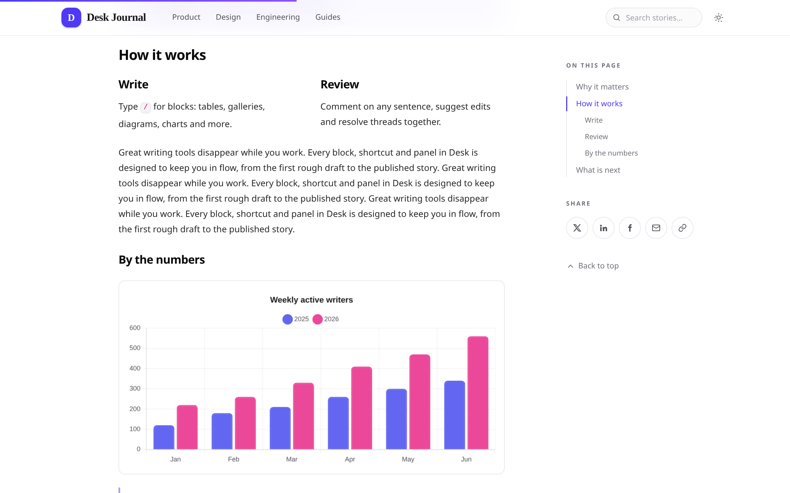</td>
  </tr>
</table>

<p align="center"><b>Mobile</b><br>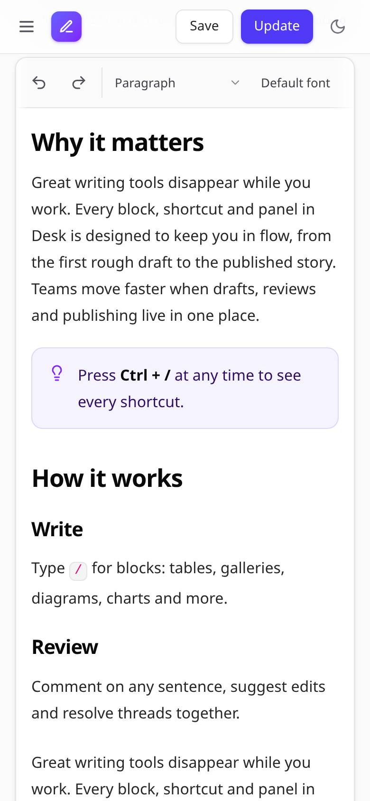</p>

## Installation

```bash
composer require atannex/desk-editor
php artisan desk-editor:install --migrate
```

The installer publishes the configuration, links public storage, and runs the package migrations.

Optional installer flags:

```bash
php artisan desk-editor:install --assets --views --lang --force
```

Add Laravel's scheduler to your deployment. Scheduled publishing runs every minute, and media pruning runs daily.

## Use the editor

Add the component to a Blade form:

```blade
<form method="POST" action="{{ route('posts.store') }}">
    @csrf

    <x-desk-editor
        name="body"
        :value="old('body', $post->body)"
        toolbar="standard"
        placeholder="Tell your story..."
        theme="auto"
        accent="#e11d48"
        min-height="24rem"
        :max-characters="20000"
        :max-words="3000"
        format="html"
    />

    <button type="submit">Save</button>
</form>
```

The editor supports `html`, `json`, and `markdown` formats. The toolbar accepts a preset, a comma-separated list, or an array. Use `|` to start a toolbar group and `->` to push items to the right.

The first editor on a page injects its stylesheet and script automatically. To manage assets yourself, set `inject_assets` to `false` and include `@deskEditorStyles` and `@deskEditorScripts`.

### Livewire

```blade
<x-desk-editor wire:model="content" />
```

The component binds the hidden input and keeps the editor itself under `wire:ignore`.

### Comments, drafts, and collaboration


Enable document-specific features with the corresponding component attributes:

```blade
<x-desk-editor
    name="body"
    :comments="'post:'.$post->id"
    :collaboration="'post:'.$post->id"
    :autosave="['key' => 'post-'.$post->id, 'server' => true]"
/>
```

Server drafts are stored per user and can be restored across devices. Live collaboration requires Laravel broadcasting and a configured broadcaster.

## Render saved content

Use the content component to render editor output for readers:

```blade
<x-desk-editor::content :html="$post->body" />
```

Content is sanitised before rendering. Editorial-only markup is removed, media receives responsive sources and dimensions, and supported features such as diagrams, charts, code highlighting, math, collapsibles, and image lightboxes are enhanced in the browser.

## Store and validate content

Use the package cast to sanitise content when it is written:

```php
use Atannex\DeskEditor\Casts\AsDeskContent;

protected function casts(): array
{
    return [
        'body' => AsDeskContent::class,
    ];
}
```

The cast provides helpers for common content tasks:

```php
$post->body->words();
$post->body->readingTime();
$post->body->excerpt(160);
$post->body->outline();
$post->body->images();
$post->body->mentions();
```

Validate content with `DeskContentRule`:

```php
DeskContentRule::make()
    ->required()
    ->minWords(50)
    ->maxCharacters(20000)
    ->maxImages(10);
```

Validation measures visible text, so empty HTML elements do not count as content.

## CMS and public blog


The article manager is available at `/desk/articles`. It includes:

- Draft, review, scheduled, published, and archived states
- Authoring, SEO fields, categories, tags, and translations
- Reviewer approval and change requests
- Revision comparisons and restore
- Edit locks and conflict detection
- Scheduled publishing and activity history

Enable the public blog with:

```env
DESK_BLOG_ENABLED=true
```

The default URL prefix is `/blog`. The blog includes article and category pages, search, related posts, threaded reader comments, RSS/Atom feeds, a sitemap, structured metadata, and analytics.

## Media processing


Uploads are recorded in the media library at `/desk/media`.

- Images can be converted into responsive WebP variants.
- Video and audio metadata and posters are generated with ffprobe.
- Video transcoding uses ffmpeg and can run through queued jobs.
- Unused media can be reviewed with a dry run:

```bash
php artisan desk-editor:prune-media --dry-run
```

SVG uploads are disabled by default. Increase PHP's `upload_max_filesize` and `post_max_size` when handling large media files.

## Filament

Use the package field in a Filament form:

```php
use Atannex\DeskEditor\Filament\DeskEditor;

DeskEditor::make('body')
    ->toolbar('standard')
    ->maxWords(3000)
    ->document(fn ($record) => $record ? 'post:'.$record->id : null)
    ->columnSpanFull();
```

The field stores sanitised HTML. Laravel Nova is not supported.

## JavaScript API

Get an editor instance and interact with it programmatically:

```js
const desk = DeskEditor.get(document.querySelector('.desk-editor'));

await desk.ready;

desk.getHTML();
desk.getMarkdown();
desk.setContent('# Hello', { format: 'markdown' });

desk.toggleSuggestionMode();
desk.toggleComments();
desk.toggleFocusMode();

desk.on('change', ({ html, words }) => {
    // Handle editor changes.
});
```

The package also emits DOM events, including `desk-editor:ready`, `desk-editor:change`, `desk-editor:upload`, and `desk-editor:peers`. Editors added dynamically are initialised automatically. To disable automatic initialisation, set `window.DeskEditorAutoInit = false` and call `DeskEditor.init(container)`.

## Configuration and security

- `theme="auto"` follows the page theme and operating-system preference; `light` and `dark` are also supported.
- Use `accent` to customise the editor's accent colour.
- The editor uses an HTML allow-list sanitiser.
- Iframes are restricted to HTTPS allow-listed hosts and sandboxed.
- Link previews validate destinations and redirects to protect against SSRF.
- Uploads are MIME-checked, stored under random names, and scoped to their owners.
- CMS routes are protected by authorization gates; configure the package gates to match your application's roles and permissions.

## Development

Regenerate the README screenshots from a running workbench with `node scripts/screenshots.mjs` (environment in `workbench/collab.env.sh`).

```bash
composer install
npm install

npm run build
composer test
npm test
npm run test:e2e
composer analyse
```

The repository includes a Testbench workbench application for trying the editor, CMS, and blog locally.

## License

MIT © Atannex.

Bundled TipTap, ProseMirror, Yjs, KaTeX, Mermaid, Chart.js, highlight.js, and Lucide icons are distributed under their respective MIT, ISC, or Apache licenses.
